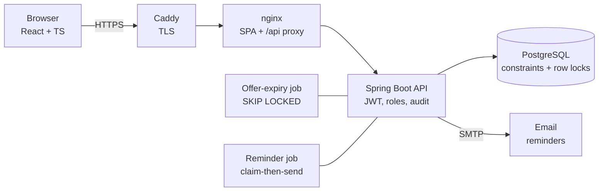

# ClinicQ

Scheduling for small clinics. Patients book appointments, staff run the day, and when someone cancels the freed slot is
automatically offered to the next person on the waitlist.

For a guided tour of this project, simple or detailed, visit my portfolio: https://kalyan-mantha.vercel.app

**Stack:** React + TypeScript (Vite) · Java 21 / Spring Boot 3 · PostgreSQL 16 · JWT auth · Flyway · Docker.
**Live demo:** https://clinicq.duckdns.org (one-click demo logins on the sign-in page). One AWS EC2 t3.small running the Docker Compose stack behind Caddy with a Let's Encrypt certificate; `docs/DEPLOY.md` is the step-by-step. For the full explanation of how everything works, read [`docs/WALKTHROUGH.md`](docs/WALKTHROUGH.md).

## The interesting problem: two people, one slot

I load tested booking with **1,000 simultaneous requests at 50 slots**, counting double-bookings in SQL afterwards.

| Version | Bookings accepted | Double-booked slots |
|---|---|---|
| v1: check, then insert (no lock, no constraint) | 54 to 58 | **4 to 6** (4 to 8 extra bookings) |
| + partial unique index on `appointments(slot_id)` | 50 | 0 |
| + `SELECT ... FOR UPDATE` on the slot row (shipped) | 50 | **0** |

My first version double-booked. The fix is two layers: the **row lock** serialises people racing for the same slot so
losers get a clean "slot taken", and the **partial unique index** (`WHERE status IN ('BOOKED','COMPLETED')`) is the
database-level guarantee that holds even if application code is wrong.

I re-ran the same test against the deployed containers on the EC2 box (2 vCPU, 2 GB RAM, a separate throwaway database): **50 accepted, 950 rejected with 409, 0 double-booked slots**, and the whole k6 run took 17 seconds. Details and caveats: [`loadtest/results/RESULTS.md`](loadtest/results/RESULTS.md).

## Architecture



## What each role sees

| Role | Can do |
|---|---|
| Patient | Browse doctors, book/cancel, join a waitlist, accept or decline a 15-minute offer, keep own encrypted details |
| Receptionist | Day schedule, cancel on a patient's behalf, waitlist queue |
| Doctor | Own day only, open a patient's record (audited), visit notes, mark complete |
| Admin | Create/disable staff, generate slots, read the audit log |

Roles are enforced on the server (URL rules + `@PreAuthorize`); the UI hiding things is a convenience, not security.

## Design decisions worth talking about

- **No double-booking:** row lock + partial unique index, proven by the load test above.
- **Idempotent booking:** `Idempotency-Key` header with a unique index on `(patient_id, key)`; a retried request returns the original appointment. The UI generates one key per selection.
- **Waitlist auto-fill:** cancelling offers the slot to the first matching person in the same transaction (a cancel can never succeed without its offer). Offers expire after 15 minutes (a background job using `FOR UPDATE SKIP LOCKED`, safe with many instances). A person who declined or let an offer lapse is never re-offered the same slot. Accept/decline/expire all lock the offer row, so only one wins: 10 simultaneous accepts give exactly one booking.
- **Reminders (24h, 2h):** a reminder is *claimed* by inserting into `reminders` (`UNIQUE(appointment_id, type)`) and then sent. Tested with two API instances sweeping at once: exactly one email each. Trade-off: a crash between claim and send loses a reminder rather than risking a double send.
- **Privacy:** phone, date of birth and notes are AES-256-GCM encrypted at the field level (random IV, tamper detection). Logs never contain emails, names or those fields (a leak scan runs in the tests). Audit rows hold ids and role labels only. The reception view exposes no sensitive fields. A doctor can only open records for their own appointments, and each open is audited.
- **Schema owned by Flyway**, Hibernate only validates (`ddl-auto: validate`). Production profile refuses to start without real secrets.

## Run it locally

Needs Java 21+, Node 20+, and Postgres 16 (or `docker compose up -d`, which also starts Mailpit for emails at http://localhost:8025).

```bash
docker compose up -d                                   # Postgres :5432 + Mailpit
cd backend  && SEED_DEMO=true mvn spring-boot:run               # API on :8080
cd frontend && npm install && npm run dev              # http://localhost:5173
```

Demo logins (password `Demo#2026!` for all): `patient@clinicq.demo`, `reception@clinicq.demo`, `doctor@clinicq.demo`, `admin@clinicq.demo`.
The login page has one-click buttons for each.

## Tests

| Layer | What | Count |
|---|---|---|
| Unit | field encryption (round trip, tamper, wrong key) | 6 |
| API integration (real Postgres, real HTTP) | booking/roles, waitlist + expiry + concurrent accepts, privacy, admin, reminders across 2 instances | 80+ checks |
| Frontend components (Vitest + Testing Library + axe) | every UI component: behaviour, keyboard use, accessibility; time-zone and polling helpers | 48 |
| Browser end-to-end (Playwright) | book, waitlist, reception cancel, offer accepted, calendar view, doctor record, audit, role guards | 6 |
| Browser accessibility (axe-core, WCAG 2.1 AA) | sign-in, patient, staff calendar and list, admin pages, keyboard-only use | 5 |
| Load | 1,000 simultaneous bookings on 50 slots, 3 versions | see above |

`scripts/test-all.sh [--load]` runs everything against a fresh database. It assumes a local Postgres superuser `postgres`
on :5432, a `clinicq` role, and the Mailpit binary; on my machine these live in a project-local `.tools/` folder.

## API at a glance

`POST /api/auth/{register,login}` · `GET /api/doctors`, `/api/slots` · `POST /api/appointments` (+`Idempotency-Key`), `GET /mine`, `DELETE /{id}` ·
`POST /api/waitlist`, `GET /mine`, `DELETE /{id}` · `GET /api/offers/mine`, `POST /{id}/accept|decline` · `GET|PUT /api/patients/me` ·
`GET /api/reception/{schedule,waitlist}` · `GET /api/doctor/schedule`, `/appointments/{id}/record`, `PUT .../notes`, `POST .../complete` ·
`/api/admin/{users,slots,audit}`.

## The frontend

The interface is a small typed component library (`frontend/src/ui`) with every component shown in Storybook (`npm run storybook`), designed first in Figma.

- **Calendar for staff.** Reception and doctors see the day as a time grid, one column per doctor, each appointment sized by its length. Click a block for details and actions; a list view is one toggle away and is the default on phones.
- **A quick, calm booking flow.** Patients pick a day from a strip that shows how many times are open, then a time. Changes show up instantly and roll back with a clear message if the server says no.
- **Offers feel live.** A held slot is a ticket with a countdown ring for the 15 minutes. Screens refresh on a timer (offers every 5 seconds) and pause while the tab is hidden. This is polling, not websockets.
- **Accessible by default.** Skip link, labelled controls, keyboard-operable calendar and radio toggle, focus moves to confirmations, status messages announced politely, and colour is never the only signal. Component tests and a browser scan with axe-core check this on every run.

Lighthouse on the live sign-in page (default mobile settings): performance 100, accessibility 100, best practices 100, SEO 100; first paint 0.8 s, no layout shift.

Run the frontend checks: `cd frontend && npm test` (components), `npm run storybook`, `npm run test:e2e` (needs the API running; `scripts/e2e.sh` does it all). CI runs typecheck, component tests, the build and the Storybook build on every push.

## Known limitations (what I'd do next)

- Tokens last 15 minutes and are renewed while the user is active (12 hour hard cap). Disabling a user takes effect at the next renewal, within 15 minutes.
- No login rate limiting or account lockout.
- The encryption key is one key from an environment variable. A KMS-managed key with rotation would be the real answer.
- Reminder emails go to Mailpit locally; for real delivery configure SMTP (Amazon SES instructions in `docs/DEPLOY.md`).
- The load test client runs on the same machine as the server (laptop, then the EC2 box), so latencies are not representative of real traffic. The double-booking counts are the point.
- The live demo is a single small instance with no backups or failover, and its reminder emails go to a mail catcher rather than real inboxes.
