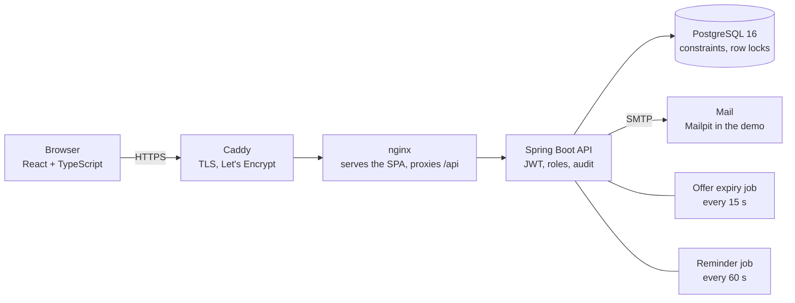
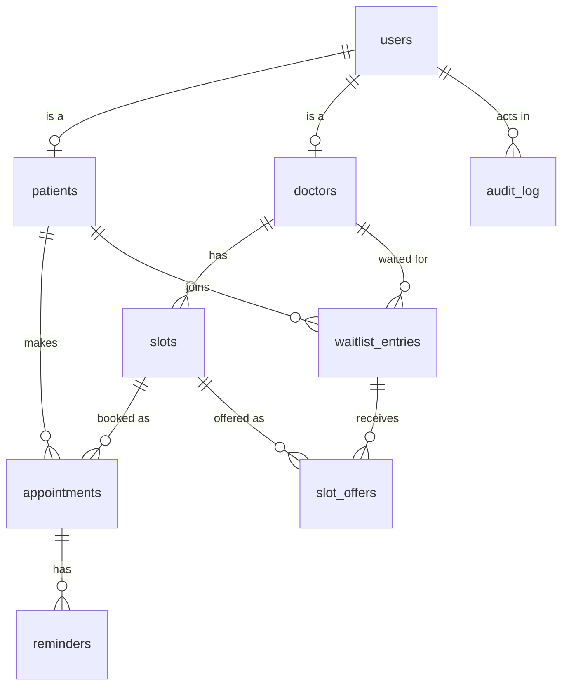
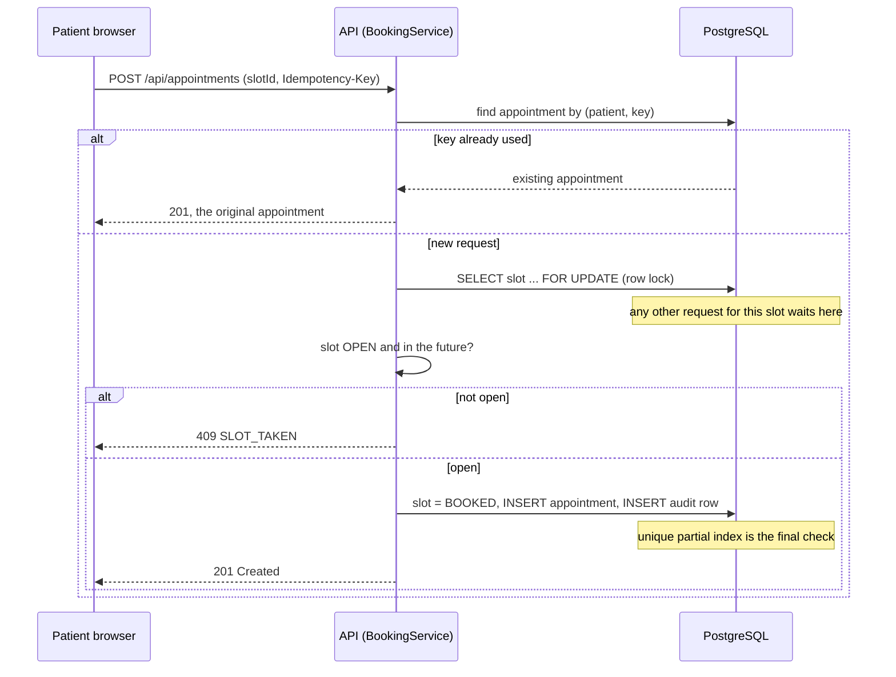
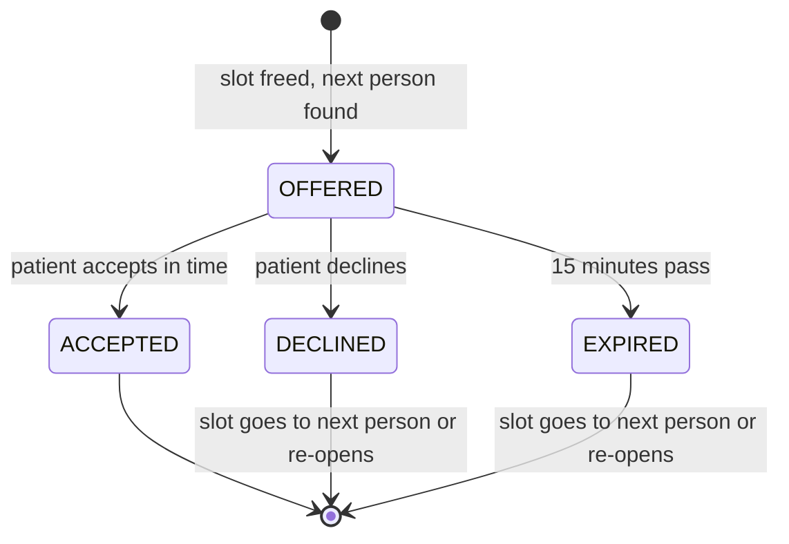
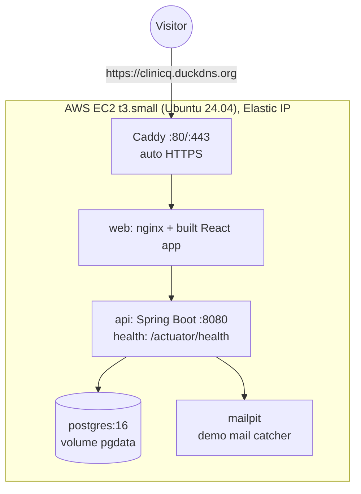

# ClinicQ walkthrough

This is the long version of the README: what the project is, why it is built the way it is, and how every part works,
from the browser down to the database. If you only want the pitch and the numbers, read [`README.md`](../README.md).
If you want to know *why* the code looks the way it does, read this.

Contents: [The idea](#1-the-idea) · [A day in the life](#2-a-day-in-the-life) · [Architecture](#3-architecture) ·
[Data model](#4-data-model) · [Booking, step by step](#5-booking-step-by-step) · [Waitlist and offers](#6-waitlist-and-offers) ·
[Background jobs](#7-background-jobs) · [Security and roles](#8-security-and-roles) · [Privacy](#9-privacy-by-design) ·
[Frontend](#10-frontend) · [Proof: tests and the load test](#11-proof-tests-and-the-load-test) ·
[Deployment](#12-deployment) · [Trade-offs and limits](#13-trade-offs-and-limits) · [Repo map](#14-repo-map)

---

## 1. The idea

A small clinic runs on its schedule. Every appointment slot that sits empty is lost money and a patient who could have
been seen. Two things go wrong in practice:

1. **Two people get the same slot.** A receptionist and a patient (or two patients) both think they booked 10:00.
2. **Cancellations are wasted.** Someone cancels an hour before, the slot stays empty, and the people who wanted an
   earlier time never find out.

ClinicQ fixes both. Patients book online and staff run the day's schedule. A slot can never be booked twice, even if
two people click at the same instant. When someone cancels, the system automatically offers the freed slot to the next
person on the waitlist, who has 15 minutes to take it before it passes to the next person.

It also does the unglamorous things a real clinic system needs: four roles that each see only what they should,
reminder emails 24 hours and 2 hours before a visit, an audit trail of who viewed or changed each record, and
encryption of the sensitive patient fields.

**Who it is for:** a clinic with a few doctors and one front desk. It is not trying to be an electronic health record.

---

## 2. A day in the life

| Role | What they do in a normal day |
|---|---|
| **Patient** | Registers, picks a doctor, books an open slot, gets reminder emails, cancels if plans change. If their preferred time was full, they joined the waitlist and may get an offer ("a slot just opened, you have 15 minutes"), which they accept or decline. They can keep a phone number, date of birth and a note for the doctor on their profile. |
| **Receptionist** | Sees the whole day's schedule across doctors, cancels an appointment on a patient's behalf (which triggers the waitlist offer), and watches the waitlist queue. They never see phone numbers, dates of birth or notes. |
| **Doctor** | Sees only their own day. Opens a patient's record for an appointment of theirs, writes visit notes, marks the visit complete. Every record they open is written to the audit log. |
| **Admin** | Creates and disables staff accounts, generates a day of slots for a doctor, reads the audit log. |

The sign-in page has one-click demo buttons for each role so a visitor can see each view in seconds.

### The story the waitlist tells

1. Pat books Dr. Chen at 10:00. Sam wanted a morning slot with Dr. Chen but everything was full, so Sam joined the waitlist.
2. Pat cancels. In the same database transaction the slot becomes *offered* to Sam and a 15-minute timer starts.
3. Sam's page shows a ticket with a countdown (it checks for offers every 5 seconds). Sam taps **Book**, and the appointment is created.
4. If Sam had ignored it, a background job would notice after 15 minutes, mark the offer expired, and offer the slot to the next person (or re-open it for everyone if nobody is waiting). Sam would not be offered that same slot again.

---

## 3. Architecture



**One request, end to end.** The browser loads the React app from nginx. Every call to `/api/...` goes through Caddy
(which terminates TLS) to nginx (which forwards `/api` to the API container). The API checks the JWT in the
`Authorization` header, applies the role rules, runs the business logic in a transaction against PostgreSQL, and
returns JSON.

**Why these pieces:**

- **Spring Boot + PostgreSQL** because correctness here is about transactions, locks and constraints, and Postgres is
  very good at all three. The no-double-booking guarantee is a database feature, not an application hope.
- **Flyway** owns the schema (`V1__init_schema.sql`, `V2__...sql`). Hibernate is set to `validate`, so the app refuses
  to start if the code and the schema disagree.
- **JdbcTemplate for the tricky parts.** Simple CRUD uses JPA repositories. The waitlist, offers and reminders use
  hand-written SQL (`FOR UPDATE`, `SKIP LOCKED`, `ON CONFLICT DO NOTHING`) because I want the locking visible in the
  code, not hidden behind an ORM.
- **Stateless API.** No server-side sessions, so more than one API instance can run behind the same database. The
  background jobs are written so that running several instances at once is safe (sections 6 and 7).
- **Docker Compose** for everything: the same images run on my laptop and on the server.

### Backend layers

```
web/        Controllers: HTTP in, DTOs out, role annotations. No business rules.
service/    BookingService, OfferService, ReminderService, AuditService, the two scheduled jobs.
repo/       Spring Data repositories for the simple tables.
domain/     Entities and enums (Appointment, Slot, User, AuditLog, statuses, roles).
security/   JWT issue/parse, the auth filter, SecurityConfig (URL rules), FieldEncryptor.
seed/       DemoDataSeeder: demo accounts and slots on an empty database.
```

---

## 4. Data model



| Table | Purpose | Notable columns |
|---|---|---|
| `users` | Every account | `role` (PATIENT, RECEPTIONIST, DOCTOR, ADMIN), `enabled`, unique `lower(email)` |
| `patients` | Patient extras | `phone_enc`, `dob_enc`, `notes_enc` (all encrypted) |
| `doctors` | Doctor extras | `specialty` |
| `slots` | A bookable time | `status` OPEN / BOOKED / OFFERED, unique `(doctor_id, start_at)`, `end_at > start_at` |
| `appointments` | A booking | `status` BOOKED / CANCELLED / COMPLETED, `idempotency_key`, `visit_notes_enc` |
| `waitlist_entries` | Someone waiting for a doctor | `preferred_window` MORNING / AFTERNOON / ANY, `status` WAITING / OFFERED / FULFILLED / LEFT |
| `slot_offers` | A freed slot offered to one entry | `status` OFFERED / ACCEPTED / EXPIRED / DECLINED, `expires_at` |
| `reminders` | Proof a reminder was claimed | `type` H24 / H2, unique `(appointment_id, type)` |
| `audit_log` | Who did what | `actor_label`, `action`, `entity_type`, `entity_id` (ids only) |

### The constraints that carry the design

The rules that must never be broken live in the schema, so they hold even if application code has a bug.

| Constraint | What it guarantees |
|---|---|
| `ux_appointments_one_active_per_slot` on `appointments(slot_id) WHERE status IN ('BOOKED','COMPLETED')` | **At most one live appointment per slot.** A cancelled booking does not block the slot, which is why it is a *partial* index. |
| `ux_appointments_idempotency` on `(patient_id, idempotency_key)` | A retried request with the same key cannot create a second appointment. |
| `ux_offers_one_open_per_slot` on `slot_offers(slot_id) WHERE status = 'OFFERED'` | A slot has at most one open offer at a time. |
| `ux_waitlist_one_active_per_doctor` on `(patient_id, doctor_id) WHERE status IN ('WAITING','OFFERED')` | A patient can wait for the same doctor only once. |
| `uq_reminder_once` on `(appointment_id, type)` | The same reminder can never be recorded, and so never be sent, twice. |
| `uq_slots_doctor_start` on `(doctor_id, start_at)` | A doctor cannot have two slots starting at the same time. |

---

## 5. Booking, step by step

`POST /api/appointments` with `{ slotId }` and an `Idempotency-Key` header. Implemented in `BookingService.book`,
inside one transaction.



### Why two layers

1. **The row lock** (`SELECT ... FOR UPDATE` on the slot). When 20 people click the same slot together, Postgres lets
   one through at a time. The first sees the slot `OPEN` and books it. The rest wake up one by one, see it is no longer
   `OPEN`, and get a clean `409 SLOT_TAKEN`. Without the lock the check ("is it open?") and the write ("book it")
   are two separate steps, and two requests can both pass the check.
2. **The unique partial index** is the backstop. Even if someone later writes new code that forgets the lock, the
   database itself refuses a second active appointment for a slot.

The README's table shows what each layer buys: the first version (check, then insert, no lock, no index)
double-booked 4 to 6 slots out of 50 under load; the index alone gives 0 but returns database errors to the losers;
index plus lock gives 0 with clean rejections.

### Idempotency

Mobile connections drop. If a patient's request times out, the browser retries. Without protection the retry could
book a second slot. The browser generates one random key per *selection* of a slot (`crypto.randomUUID()` when the
patient picks a time). The API looks up `(patient_id, key)` first and, if found, returns the original appointment. The
unique index makes this safe even if two retries arrive at the same moment.

### Cancelling

`DELETE /api/appointments/{id}`. Patients can cancel their own; receptionists and admins can cancel anyone's.

1. Locks the slot row.
2. Marks the appointment `CANCELLED` (cancelling twice is a no-op, so retries are harmless).
3. Calls `offerOrReopen`, which either offers the slot to the next person or re-opens it (section 6).
4. Writes an audit row.

All four happen in one transaction, so **a cancellation can never succeed without its offer or re-open**.

---

## 6. Waitlist and offers

Slot status moves between `OPEN`, `OFFERED` and `BOOKED`. An offer's own life is separate:



### Choosing who gets the offer

`OfferService.offerOrReopen` runs one query that picks the **first matching waiting entry** by `created_at`:

- same doctor as the slot,
- status `WAITING`,
- preferred window fits (`MORNING` means the slot starts before 12:00 clinic time, `AFTERNOON` means 12:00 or later, `ANY` fits all; clinic time is `America/Los_Angeles`),
- not the person who just cancelled,
- **never someone who already had an offer for this slot** (they declined or let it lapse),

and it uses `FOR UPDATE OF e SKIP LOCKED` so that two cancellations at the same time do not fight over the same waiting
person. If it finds someone: slot becomes `OFFERED`, a `slot_offers` row is inserted with `expires_at = now() + 15 min`,
the entry becomes `OFFERED`, and the audit log records `OFFER_SLOT` by "system". If nobody matches: the slot goes back
to `OPEN` for everyone.

### Responding

Accept, decline and expire **all lock the offer row first**, so only one of them can win:

- **Accept**: checks the offer is still `OFFERED` and not past `expires_at`, locks the slot, books it, marks the offer `ACCEPTED` and the entry `FULFILLED`. If the offer already expired or was taken, the patient gets `409 OFFER_EXPIRED` or `OFFER_NOT_AVAILABLE`.
- **Decline**: marks the offer `DECLINED`, puts the person back to `WAITING`, and immediately offers the slot onward.
- A patient cannot leave the waitlist while holding an open offer (`409 RESPOND_TO_OFFER_FIRST`).
- Someone else's offer id returns `404`, not `403`, so offers cannot be probed.

I tested this with 10 simultaneous accepts of the same offer: exactly one booking results.

---

## 7. Background jobs

Both jobs are Spring `@Scheduled` methods. Neither assumes it is the only copy running.

### Offer expiry (every 15 seconds)

`OfferService.expireOne()` finds the oldest overdue offer with `FOR UPDATE SKIP LOCKED`, expires it, returns the entry
to `WAITING`, and calls `offerOrReopen` for the slot. The job loops until nothing is overdue, each offer in its own short
transaction. `SKIP LOCKED` means that if several API instances run the sweep at once, each grabs different offers
and none waits on another.

The timer is therefore accurate to about 15 seconds. The accept endpoint also checks `expires_at <= now()` itself, so
an expired-but-not-yet-swept offer cannot be accepted.

### Reminders (every 60 seconds)

A reminder is **claimed first, then sent**:

1. Find BOOKED appointments inside a reminder window that have no row in `reminders` for that type (24-hour window: more than 2 hours and up to 24 hours away; 2-hour window: up to 2 hours away). Someone who books three hours ahead gets only the 2-hour reminder.
2. `INSERT INTO reminders ... ON CONFLICT DO NOTHING`. Whichever API instance inserts the row owns the send; the other sees 0 rows and skips.
3. Send the email. If sending fails, the claim row is deleted so the next sweep retries.

I tested this with two API instances sweeping at the same moment: exactly one email each. The trade-off I chose on
purpose: a crash *between* claiming and sending loses one reminder, rather than risking sending twice. For a
reminder, a missed email is a smaller harm than a duplicate.

Failures are logged by exception class only, never with the address.

---

## 8. Security and roles

**Authentication.** `POST /api/auth/login` checks the password with BCrypt and returns a JWT. The token holds only the
user id, the role and the time the person actually typed their password. It does not contain an email or a name.
Registration only ever creates a `PATIENT`; staff accounts are created by an admin.

**Sliding session.** The token lasts 15 minutes. While a person is actually using the page, the browser swaps it for a
fresh one (`POST /api/auth/refresh`) when under 5 minutes remain. The refresh keeps the *original* sign-in time, so
there is a hard cap of 12 hours; after that the person must sign in again. A refresh also re-checks that the account
is still enabled. Background polling does not count as activity, so a forgotten open tab will expire.

**Authorisation is enforced on the server in two places:**

- URL rules in `SecurityConfig`: `/api/admin/**` is admin only, `/api/reception/**` is receptionist or admin, `/api/doctor/**` is doctor only, everything else needs a valid token.
- `@PreAuthorize` on the controller methods that are patient-only, for example booking and the waitlist.

The UI hides links a role cannot use, but that is a convenience. If a patient pasted an admin URL, the API would
answer `403`.

**Row-level rules.** A doctor's record query is `WHERE appointment id = ? AND doctor = me`. Asking for another
doctor's patient returns `404` as though it does not exist. Patients can only cancel their own appointments and only
see their own offers.

**Audit log.** `AuditService.record` joins the caller's transaction, so the audit row and the change it describes commit
or roll back together. It records the actor id, a role label, an action (for example `BOOK_APPOINTMENT`,
`CANCEL_APPOINTMENT`, `VIEW_PATIENT_RECORD`, `UPDATE_VISIT_NOTES`, `OFFER_SLOT`, `EXPIRE_OFFER`, `SEND_REMINDER_H24`) and
the id of the thing touched. Never a name, email or any patient detail. Background jobs appear as actor "system".

---

## 9. Privacy by design

- **Field-level encryption.** Phone, date of birth, the patient's own notes, and the doctor's visit notes are encrypted
  with AES-256-GCM before they reach the database. Each value gets a fresh random 12-byte IV, so identical inputs give
  different ciphertext, and GCM's authentication tag makes any tampering fail loudly when decrypted. The stored form
  is `v1:` plus base64, so a future key rotation can tell formats apart. The 32-byte key comes from the
  `FIELD_ENCRYPTION_KEY` environment variable; the production profile refuses to start without it.
- **Need-to-know views.** The reception schedule query does not select any of those fields at all. A doctor decrypts
  only the record of their own appointment, and that read is audited.
- **No patient data in logs.** Log lines carry exception class names and counts, never emails, names or field values.
  The test suite includes a scan of the logs for leaks.
- **Minimal tokens.** The JWT has an id and a role only.
- **Production refuses unsafe defaults.** Secrets have no usable default in the production profile.

---

## 10. Frontend

React 18 + TypeScript, built with Vite, served by nginx in production.

```
src/main.tsx, App.tsx    Routes, one <Guard role=...> per protected route
src/auth.tsx             Session state, sliding renewal, activity tracking
src/api.ts               One fetch wrapper; 401 sends you to sign-in and remembers where you were
src/hooks.ts             useLoad(fn, deps, pollMs): fetch + loading/error + optional polling
src/pages/auth.tsx       Sign-in, register, demo-account buttons, "you were signed out" notice
src/pages/patient.tsx    My care (offer ticket, upcoming, waitlist), find a doctor, book, my details
src/pages/staff.tsx      Reception day, reception waitlist, doctor's day, patient record
src/pages/admin.tsx      Users, create slots, audit log
```

Things worth knowing:

- **Polling, not websockets.** The patient page re-checks for offers every 5 seconds, appointments and waitlist every 15, and the admin audit log every 10. Simple, and fine at clinic scale. Server push would be the upgrade.
- **Session renewal** listens for pointer, key, touch and scroll events and only renews if the person was active in the last 10 minutes.
- **Idempotency keys** are generated when a slot is picked, so a double-click or a retry reuses the same key.
- **Role guards** in the router redirect people away from pages that are not theirs, but the API is the real enforcement.
- **Confirm before cancel**: cancelling takes a second, explicit "Yes, cancel it" click.

---

## 11. Proof: tests and the load test

| Layer | What it covers |
|---|---|
| Unit | Field encryption: round trip, tamper detection, wrong key (6 tests) |
| API integration (real Postgres, real HTTP), 80+ checks | Booking and role rules, waitlist, expiry and 10 concurrent accepts, privacy (log scan), admin actions, reminders across two API instances |
| Browser end-to-end (Playwright), 5 specs | Book, waitlist, reception cancel, offer accepted, doctor record, audit, role guards |
| Load (k6) | 1,000 simultaneous bookings on 50 slots, three versions of the booking code |

`scripts/test-all.sh [--load]` runs the suite against a fresh database.

### The load test

1,000 simulated patients each send one booking request at the same moment, each at a random one of 50 open slots.
Afterwards **SQL, not the API's responses, counts the double-bookings** (appointments grouped by slot), so a bug in
the code cannot hide from the test.

| Version | Accepted | Double-booked slots |
|---|---|---|
| Check then insert, no lock, no index | 54 to 58 | 4 to 6 |
| Unique index only | 50 | 0 |
| Row lock + unique index (shipped) | 50 | 0 |

The deployed run on the AWS server gave 50 accepted, 950 rejected with `409`, 0 double-booked, in 17 seconds. Full
numbers and caveats: [`loadtest/results/RESULTS.md`](../loadtest/results/RESULTS.md). The "naive" version still exists
in the code behind `BOOKING_MODE=naive`, solely so the bug can be reproduced.

---

## 12. Deployment



- **One instance, five containers** in `docker-compose.prod.yml`: Postgres, API, web (nginx), Caddy, and Mailpit.
  Caddy publishes ports 80 and 443. The database and API are not reachable from outside (Mailpit publishes 8025, but the security group keeps that port closed).
- **HTTPS** is automatic: Caddy asks Let's Encrypt for a certificate for the domain named in `SITE_ADDRESS` and renews it.
  The free domain is a DuckDNS subdomain pointing at the Elastic IP.
- **Secrets** (`DB_PASSWORD`, `JWT_SECRET`, `FIELD_ENCRYPTION_KEY`) live in a `.env` file on the server, are required by
  the compose file, and are not in the repository.
- **Health checks**: Postgres reports ready, then the API starts, and the API's own check hits `/actuator/health`
  (which deliberately ignores the mail server, so SMTP being down does not mark the API unhealthy).
- **Memory**: the box has 2 GB RAM, so a 2 GB swap file keeps the JVM and Postgres from being killed.
- **SSH** is restricted to my own IP in the security group.
- **Demo data** seeds only an empty database (`SEED_DEMO`), with the four demo accounts and some slots.
- **Cost**: about $20 a month while running, about $5 while stopped (disk and the static IP). Step-by-step:
  [`DEPLOY.md`](DEPLOY.md).

---

## 13. Trade-offs and limits

I would rather state these than have them found.

- **Offer timing is a 15-second sweep**, not an exact timer. The accept endpoint checks the clock itself so an overdue offer can never be accepted.
- **A reminder can be lost, never doubled**, if the server dies between claiming and sending.
- **Polling instead of push**, so an offer appears within 5 seconds, not instantly.
- **Disabling a user** takes effect at the next token renewal, within 15 minutes. Immediate revocation would need a token blocklist or a per-request user check.
- **No login rate limiting or lockout** yet.
- **One encryption key** from an environment variable. The real answer is a managed key (KMS) with rotation; the `v1:` prefix is there to make that migration possible.
- **No backups or failover** on the live demo; it is a single small instance. Reminder emails go to a mail catcher, not real inboxes (Amazon SES setup is documented).
- **Load test client and server share a machine**, so the latency figures are not realistic. The double-booking counts are the point.
- **Not an EHR.** There is no medical history, billing, insurance or scheduling rules beyond fixed-length slots.

---

## 14. Repo map

```
backend/        Spring Boot API (Java 21), Flyway migrations, tests, smoke scripts
frontend/       React + TypeScript app, Playwright end-to-end spec
loadtest/       k6 script, seed SQL, run script, results
deploy/         Caddyfile
docs/           This walkthrough and DEPLOY.md
scripts/        Local start, end-to-end and test-all helpers
docker-compose.yml        Local Postgres + Mailpit
docker-compose.prod.yml   Production-style stack
```
